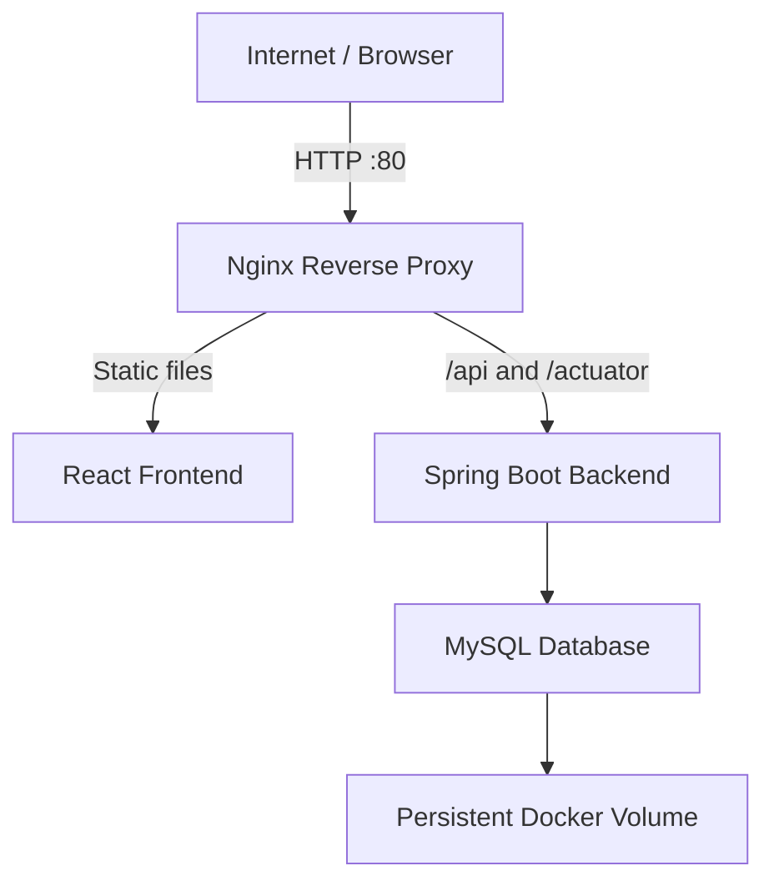

# CAP-46 – Reverse Proxy Failure Isolation & Safe Configuration Rollout

## 1. Project Overview

CAP-46 is a DevOps capstone project that demonstrates how to deploy and operate a containerized web application using Nginx as a reverse proxy.

The project focuses on maintaining frontend availability during backend failures and safely deploying Nginx configuration changes with automatic rollback.

The application consists of:

- React frontend
- Spring Boot backend
- MySQL database
- Nginx reverse proxy
- Docker and Docker Compose
- Python-based integration testing
- Bash and PowerShell automation
- GitHub Actions CI pipeline
- AWS EC2 deployment

## 2. Problem Statement

In a traditional web application, frontend and backend services may become unavailable together when the application architecture is not properly isolated.

Configuration mistakes can also cause reverse proxy failures during deployment.

This project addresses these challenges by:

- Serving frontend static files independently through Nginx.
- Routing API requests to the internal Spring Boot backend.
- Returning a controlled HTTP 503 response when the backend is unavailable.
- Validating Nginx configurations before deployment.
- Maintaining configuration backups.
- Automatically rolling back unsuccessful deployments.
- Testing application recovery and database persistence.

## 3. Architecture



### Network Design

| Service     | Internal Port | Publicly Exposed |
| ----------- | ------------: | ---------------- |
| Nginx       |            80 | Yes              |
| Spring Boot |          8080 | No               |
| MySQL       |          3306 | No               |

Only Nginx is publicly accessible. Backend and database communication happens through the internal Docker network.

## 4. Technology Stack

| Technology      | Purpose                              |
| --------------- | ------------------------------------ |
| React           | Frontend dashboard                   |
| Spring Boot     | Backend REST APIs                    |
| MySQL 8.4       | Persistent database                  |
| Nginx           | Reverse proxy and static file server |
| Docker          | Containerization                     |
| Docker Compose  | Service orchestration                |
| Python / Pytest | Integration testing                  |
| Bash            | Linux automation                     |
| PowerShell      | Windows deployment automation        |
| Git / GitHub    | Source control                       |
| GitHub Actions  | Continuous integration               |
| AWS EC2         | Cloud deployment                     |

## 5. Application Behavior

### Normal Operation

- Browser requests the frontend through Nginx.
- Nginx serves React static files.
- API requests are forwarded to Spring Boot.
- Spring Boot communicates with MySQL.

### Backend Failure Isolation

When the backend becomes unavailable:

- Frontend remains accessible.
- API requests receive HTTP 503.
- Nginx returns a controlled JSON error response.
- Restarting the backend restores API functionality.

Example response:

```json
{
  "status": "DOWN",
  "message": "Backend service is temporarily unavailable"
}
```

## 6. Safe Nginx Configuration Deployment

The project maintains separate directories for:

- Active configuration
- Candidate configurations
- Configuration backups
- Validation files

The deployment process:

1. Check application services.
2. Validate candidate configuration.
3. Back up the active configuration.
4. Promote the candidate configuration.
5. Validate Nginx configuration.
6. Reload Nginx.
7. Run smoke tests.
8. Roll back automatically if deployment validation fails.

## 7. Local Setup

### Prerequisites

- Git
- Docker Desktop
- Docker Compose
- Java 21
- Maven
- Node.js
- Python
- PowerShell or Bash

### Clone the repository

```bash
git clone https://github.com/Phanindra1801/Devops-Capestone-Project.git
cd Devops-Capestone-Project
```

### Configure environment variables

Create a local `.env` file using `.env.example` as a template.

Never commit actual credentials.

### Start the application

```bash
docker compose up -d --build
```

### Check services

```bash
docker compose ps
```

### Access the application

```text
http://localhost/
```

## 8. Useful Docker Commands

```bash
docker compose ps
docker compose logs -f
docker compose logs backend
docker compose restart backend
docker compose stop backend
docker compose start backend
docker compose up -d --build
```

Avoid `docker compose down -v` when you need to preserve database data.

## 9. Testing

The project includes Python integration tests for:

- Frontend availability
- Backend health endpoint
- Application information endpoint
- Deployment events endpoint
- Actuator health
- API response contracts
- Backend failure isolation
- Database persistence

Run the tests locally:

```bash
python -m pytest -v
```

## 10. Automation Scripts

### Bash scripts

The project includes scripts for:

- Environment validation
- Service health checks
- Nginx configuration validation
- Configuration backups
- Configuration rollback
- Smoke testing
- Safe Nginx deployment

### PowerShell

The PowerShell deployment script performs candidate validation, backup, configuration promotion, reload, smoke testing, and rollback when required.

## 11. CI Pipeline

GitHub Actions automates the validation process.

The workflow includes:

1. Backend Maven tests.
2. Frontend linting and production build.
3. Docker-based integration testing.
4. Nginx candidate configuration validation.
5. Python integration tests.

## 12. AWS Deployment

The application is deployed on an AWS EC2 instance using Docker Compose.

### Deployment architecture

```text
Internet
   |
   | HTTP :80
   |
AWS EC2
   |
   +-- Nginx Container
   |
   +-- Spring Boot Container
   |
   +-- MySQL Container
          |
          +-- Persistent Docker Volume
```

### Security group requirements

| Port | Purpose | Access                          |
| ---- | ------- | ------------------------------- |
| 22   | SSH     | Restricted to administrator IP  |
| 80   | HTTP    | Public                          |
| 443  | HTTPS   | Public when HTTPS is configured |

Backend port 8080 and MySQL port 3306 must not be publicly exposed.

### Verify deployment

```bash
docker compose ps
curl -i http://localhost/
curl -i http://localhost/api/health
curl -i http://localhost/actuator/health
```

## 13. Failure and Recovery Validation

The following scenarios were tested:

| Scenario                     | Expected Result                             |
| ---------------------------- | ------------------------------------------- |
| Normal application operation | Frontend and APIs available                 |
| Backend stopped              | Frontend remains available                  |
| Backend stopped              | API returns controlled HTTP 503             |
| Backend restarted            | API returns HTTP 200                        |
| Invalid Nginx candidate      | Configuration rejected                      |
| Failed Nginx rollout         | Previous configuration restored             |
| Backend restart              | Existing database records retained          |
| EC2 reboot                   | Services recover and database data persists |

## 14. Database Persistence

MySQL data is stored in a named Docker volume.

This ensures that restarting containers or rebooting the EC2 instance does not automatically erase existing database records.

Do not remove the database volume during normal application maintenance.

## 15. Future Enhancements

- HTTPS with an SSL certificate.
- Custom domain configuration.
- CloudWatch monitoring and alerts.
- Automated production deployment.
- Container image vulnerability scanning.
- Enhanced observability and centralized logging.

## 16. Author

**Project:** CAP-46 – Reverse Proxy Failure Isolation & Safe Configuration Rollout

**GitHub:** https://github.com/Phanindra1801/Devops-Capestone-Project

---

This project demonstrates practical experience with reverse proxies, container orchestration, service failure isolation, configuration management, automated testing, CI pipelines, and cloud deployment.
